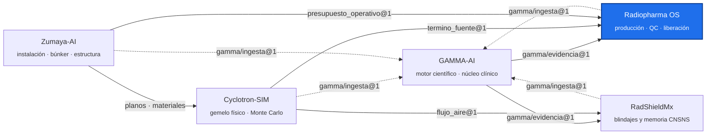

<!-- encabezado-gamma -->
<div align="center">

# Radiopharma OS

**Operación de una radiofarmacia con ciclotrón: producción, QC, liberación y trazabilidad**

[](https://github.com/plaeyade/radiopharma-os/actions/workflows/ci.yml) [](https://github.com/plaeyade/radiopharma-os/actions/workflows/imagen.yml)    

[Objetivos](#objetivos) · [Servicios (FastAPI)](#servicios-fastapi) · [Pipelines principales (`pipelines/`)](#pipelines-principales-pipelines) · [Contenedores](#contenedores) · [Uso](#uso) · [Ecosistema GAMMA](#ecosistema-gamma)

</div>

> [!IMPORTANT]
> Repositorio privado, de uso interno. Las recomendaciones de QC y los rendimientos son herramientas técnicas: la liberación de lotes la firma el responsable sanitario.
<!-- /encabezado-gamma -->

Plataforma de operación de una radiofarmacia con ciclotrón: datos nucleares, rendimiento de
producción, planeación semanal contra el ciclotrón real, control de calidad y liberación,
telemetría, trazabilidad y costos. Corresponde a la fase **B.17 (Radiopharma OS & Nuclear Medicine
Operations)** del plan canónico de GAMMA.

**Versión: v3.21.0** (ver `CHANGELOG.md`).

## Objetivos

1. **Planear contra la instalación real.** El plan de producción se verifica contra tres fuentes:
   - el ciclotrón IBA KIUBE (contrato `cyclotron-sim/termino_fuente@1`);
   - el presupuesto de blindaje del edificio (`zumaya-ai/presupuesto_operativo@1`);
   - la actividad teórica calculada con datos IAEA.
2. **Distinguir hechos.** Actividad teórica, medida, preparada y administrada son hechos
   distintos (B.17). El tablero compara lo medido con lo teórico, lote por lote.
3. **QC trazable.** Las especificaciones están versionadas y la recomendación de liberación,
   rechazo o revisión queda auditada.
4. **Cada ficha con su fuente.** Las fichas por isótopo y del ciclotrón citan documento, página y
   fragmento obtenidos de GAMMA-AI.

## Servicios (FastAPI)

| Servicio | Puerto | Función |
|---|---|---|
| `nuclear_data_service` | 8001 | Biblioteca de radionúclidos versionada: decaimiento, espectros, EXFOR/NNDC |
| `yield_engine` | 8002 | Rendimiento EOB/EOS por reacción y blanco (secciones eficaces IAEA, frenado), lotes |
| `data_lake_service` | 8003 | Evidencia, hilo digital, PDF de expediente de lote (EBR) |
| `auth_service` | 8004 | Autenticación y roles (Keycloak opcional) |
| `qc_engine` | 8005 | Protocolos y especificaciones de QC; Release Engine (liberación / rechazo / revisión) |
| `telemetry_service` | 8006 | Telemetría de planta (OPC UA / MQTT) |
| `process_service` | 8007 | Gemelo de proceso: KPIs y costos |
| `surrogate_service` | 8008 | Modelos sustitutos y agentes (cap. 20) |

`console/` es la consola web (React, servida por nginx en el puerto 8080). `dashboard/` contiene
los tableros de Grafana y Streamlit, y `airflow/dags/` la orquestación.

## Pipelines principales (`pipelines/`)

| Pipeline | Qué hace |
|---|---|
| `plan_produccion.py` | Plan semanal (F-18 con doble haz, Ga-68, Cu-64) frente al KIUBE, el blindaje y el EOB teórico. Agrega fichas citadas por GAMMA |
| `tablero_produccion.py` | Tablero por lote: EOB teórico frente al medido, rendimiento de blanco, rendimiento de síntesis corregido por decaimiento y QC. Salida JSON o HTML |
| `gamma_evidencia.py` | Cliente de GAMMA: consulta en vivo (`GAMMA_URL`) o paquete versionado; verifica el SHA-256 de cada cita |
| `ecosistema.py` | Contratos con Cyclotron-SIM y Zumaya-AI |
| `lote_fdg_f58.py`, `batch_cli.py`, `qc_cli.py`, `ebr_cli.py` | Lotes, QC y expediente de lote |

El índice de las fases históricas (F1–F97) y su ubicación actual está en `docs/FASES.md`. La
física del gemelo KIUBE vive en Cyclotron-SIM y la del edificio en Zumaya-AI.

## Contenedores

`docker-compose.yml`:

| Servicio | Imagen | Puerto |
|---|---|---|
| Servicios de la plataforma (8) | `Dockerfile` (python:3.12-slim) | 8001–8008 |
| `console` | `console/Dockerfile` (nginx) | 8080 |
| `postgres` | postgres:16-alpine | 5432 |
| `minio` | minio/minio | 9000 |
| `influxdb` | influxdb:2.7-alpine | 8086 |
| `redis` | redis:7-alpine | 6379 |
| `mosquitto` | eclipse-mosquitto:2 | 1883 |
| `opcua-sim` | python:3.12-slim | 4840 |
| `verapdf` | verapdf/verapdf:1.26 | — |
| `osrm` | osrm/osrm-backend | 5000 |

Pilas opcionales: `docker-compose.dashboards.yml` (Grafana 11.2 y Streamlit) y
`docker-compose.keycloak.yml` (Keycloak 26.0).

## Uso

```bash
pip install -r requirements-lock.txt   # Python 3.12 (la CI usa 3.12)
make test                              # todas las pruebas
make nds   # un servicio en local (ye, dl, auth, qc, tel, process, surrogate: ver Makefile)
make up / make down                    # pila Docker
python pipelines/plan_produccion.py                                   # plan semanal (JSON)
python pipelines/tablero_produccion.py pipelines/fixtures/lotes_ejemplo.json --html tablero.html
```

Variables útiles:
- `CYCLOTRON_SIM_RAIZ` y `ZUMAYA_RAIZ`: rutas a los repos hermanos. Sin ellas se usan las copias
  versionadas de sus contratos.
- `GAMMA_URL`: servicio de evidencia de GAMMA (`gamma ecosistema servir`).
- `RPOS_AGENTS_ROOT`: raíz de la evidencia de fases fuera de git. Sin ella, las pruebas que la
  requieren se omiten con motivo; `RPOS_REQUIRE_EVIDENCIA=1` hace que fallen.

## Integración con el ecosistema

| Con | Contrato | Dónde |
|---|---|---|
| **Cyclotron-SIM** | `cyclotron-sim/termino_fuente@1` | `pipelines/ecosistema.py` |
| **Zumaya-AI** | `zumaya-ai/presupuesto_operativo@1` | `pipelines/fixtures/presupuesto_operativo_zumaya.json` |
| **GAMMA-AI** | `gamma/evidencia@1`, `gamma/paquete_evidencia@1` | `pipelines/gamma_evidencia.py`, `pipelines/fixtures/gamma_evidencia_produccion.json` |

## Calidad

La CI (`.github/workflows/ci.yml`) corre `make test` con Python 3.12 en cada PR. Las pruebas no
escriben en datos versionados. Detalle de la depuración en `docs/DEPURACION.md`.

## Pendientes conocidos

- Sólo existe protocolo de QC para FDG. Ga-68 y Cu-64 aparecen como «sin protocolo» hasta cargar
  sus monografías (FEUM o Ph. Eur.) en GAMMA.
- Los rendimientos reales de blanco y síntesis requieren datos de producción. El EOB del plan es
  teórico.

## Documentación

- `docs/FASES.md`: índice de fases.
- `docs/ecosistema.md`: contratos.
- `docs/VALIDATION.md`, `docs/protocolos_iq_oq.md`: validación y calificación.
- `docs/despliegue_*.md`: despliegue.
- `docs/README-historico.md`: README anterior, con el detalle por capítulo y fase.

## Ecosistema GAMMA

Cinco repositorios privados unidos por contratos JSON versionados, no por imports. Este repositorio
está resaltado.



## Confidencialidad y licencia

Software propietario de uso individual del titular; no es de código abierto ni se distribuye.
Los documentos fuente son propiedad del titular, que tiene los derechos de uso. Ningún dato de
pacientes reales entra a este repositorio: los datos clínicos permanecen anonimizados y fuera de
GitHub. Las salidas técnicas no sustituyen la revisión ni la firma del profesional responsable.
