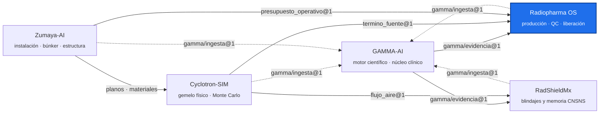

<!-- encabezado-gamma -->
<div align="center">

# Radiopharma OS

**Operación de una radiofarmacia con ciclotrón: producción, QC, liberación y trazabilidad**

[](https://github.com/plaeyade/radiopharma-os/actions/workflows/ci.yml) [](https://github.com/plaeyade/radiopharma-os/actions/workflows/imagen.yml)    

[Qué aporta](#qué-aporta) · [Capacidades](#capacidades) · [Sustento científico](#sustento-científico) · [Integración con el ecosistema](#integración-con-el-ecosistema) · [Contenedores](#contenedores) · [Ecosistema GAMMA](#ecosistema-gamma)

</div>

> [!IMPORTANT]
> Repositorio privado, de uso individual del titular. Las recomendaciones de control de calidad y los rendimientos son herramientas técnicas: la liberación de cada lote la firma el responsable sanitario.
<!-- /encabezado-gamma -->

Radiopharma OS opera una radiofarmacia con ciclotrón: datos nucleares, rendimiento de producción,
planeación semanal contra el ciclotrón real, control de calidad y liberación, telemetría,
trazabilidad del lote y costos.

## Qué aporta

- **Planear contra la instalación real.** El plan semanal se verifica a la vez contra el ciclotrón
  IBA KIUBE (término fuente de Cyclotron-SIM), el presupuesto de blindaje del edificio (Zumaya-AI) y
  la actividad teórica calculada con datos nucleares del OIEA.
- **Hechos distintos, no un solo número.** Actividad teórica, medida, preparada y administrada se
  registran por separado y se comparan lote por lote.
- **Liberación auditada.** Especificaciones de QC versionadas; la recomendación de liberar,
  rechazar o revisar queda registrada con su fundamento.

## Capacidades

| Servicio | Puerto | Qué hace |
|---|---|---|
| `nuclear_data_service` | 8001 | Biblioteca de radionúclidos versionada: decaimiento, espectros, EXFOR/NNDC |
| `yield_engine` | 8002 | Rendimiento EOB/EOS por reacción y blanco grueso: σ(E) del OIEA y poder de frenado ATIMA |
| `data_lake_service` | 8003 | Evidencia, hilo digital y expediente de lote (EBR) en PDF |
| `auth_service` | 8004 | Autenticación y roles |
| `qc_engine` | 8005 | Protocolos y especificaciones de QC; motor de liberación |
| `telemetry_service` | 8006 | Telemetría de planta (OPC UA, MQTT) |
| `process_service` | 8007 | Gemelo de proceso: indicadores y costos |
| `surrogate_service` | 8008 | Modelos sustitutos |

| Flujo | Qué hace |
|---|---|
| `pipelines/plan_produccion.py` | Plan semanal de F-18 (doble haz), Ga-68 y Cu-64 con fichas citadas por GAMMA |
| `pipelines/tablero_produccion.py` | EOB teórico frente al medido, rendimiento de blanco y de síntesis, QC por lote |
| `pipelines/gamma_evidencia.py` | Evidencia de GAMMA en vivo o por paquete, con SHA-256 verificado |

## Sustento científico

| Fuente | Uso |
|---|---|
| IAEA, secciones eficaces recomendadas para producción de radionúclidos | σ(E) de cada reacción |
| CATIMA/ATIMA (GSI) y NIST PSTAR | Poder de frenado de protones en blancos |
| NNDC/ENSDF | Semividas y datos de decaimiento |
| IBA Cyclone KIUBE SRG | Corriente, puertos y blancos del ciclotrón |
| Farmacopeas (FEUM, Ph. Eur.) | Especificaciones de QC (FDG; Ga-68 y Cu-64 al cargar sus monografías) |

## Integración con el ecosistema

| Con | Contrato | Uso |
|---|---|---|
| Cyclotron-SIM | `cyclotron-sim/termino_fuente@1` | Corriente, energía y rendimiento por puerto |
| Zumaya-AI | `zumaya-ai/presupuesto_operativo@1` | Límite de µA·h por semana con el que se diseñó el blindaje |
| GAMMA-AI | `gamma/evidencia@1`, `gamma/paquete_evidencia@1` | Fichas por isótopo y del ciclotrón con cita verificable |

Diferencia con los demás repositorios: aquí se **opera** la producción. La física del ciclotrón
vive en Cyclotron-SIM, la del edificio en Zumaya-AI y la evidencia documental en GAMMA-AI.

## Contenedores

| Imagen | Contenido |
|---|---|
| `Dockerfile` (raíz) | Yield Engine con uvicorn en el puerto 8002; la construcción corre su suite de pruebas y la imagen ejecuta sin privilegios |
| `docker-compose.yml` | Los 8 servicios, consola web y PostgreSQL, MinIO, InfluxDB, Redis, Mosquitto, simulador OPC UA |

```bash
docker build -t radiopharma-os:dev .
docker run -d --name rpos -p 8002:8002 radiopharma-os:dev    # http://localhost:8002/docs
docker compose up -d                                          # plataforma completa
```

## Uso

```bash
pip install -r requirements-lock.txt     # Python 3.12
make test                                # todas las pruebas
python pipelines/plan_produccion.py
python pipelines/tablero_produccion.py pipelines/fixtures/lotes_ejemplo.json --html tablero.html
```

Variables: `CYCLOTRON_SIM_RAIZ`, `ZUMAYA_RAIZ` (repos hermanos; sin ellas se usan las copias
versionadas de sus contratos) y `GAMMA_URL` (servicio de evidencia).

## Colaboraciones

Abierto a colaboradores invitados: radiofarmacéuticos (protocolos de QC y monografías), físicos de
ciclotrón (blancos y rendimientos medidos) e ingenieros de proceso (DWSIM, telemetría).

## Hoja de ruta

1. Protocolos de QC de Ga-68 y Cu-64 con sus monografías.
2. Rendimientos medidos de blanco y síntesis para calibrar el EOB teórico.
3. Gemelo de proceso con DWSIM (F85–F86).

## Ecosistema GAMMA

Cinco repositorios privados unidos por contratos JSON versionados, no por imports. Este repositorio
está resaltado.



## Confidencialidad y licencia

Software propietario de uso individual del titular; no es de código abierto ni se distribuye.
Los documentos fuente son propiedad del titular, que tiene los derechos de uso. Ningún dato de
pacientes reales entra a este repositorio: los datos clínicos permanecen anonimizados y fuera de
GitHub. Las salidas técnicas no sustituyen la revisión ni la firma del profesional responsable.
